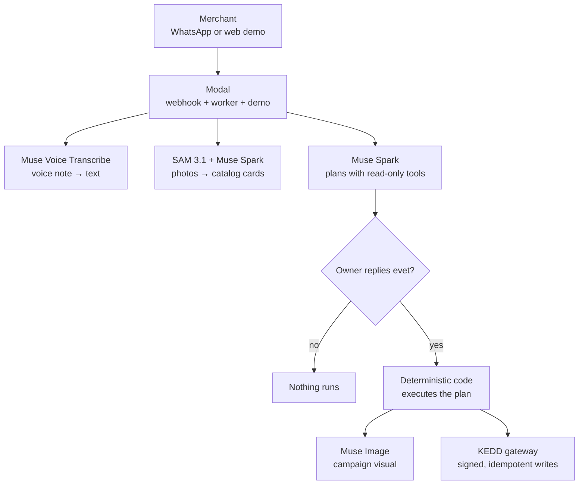

# Çırak — Merchant Action Agent

A WhatsApp agent for small businesses: the merchant talks, Çırak plans, the merchant approves with one word, deterministic code executes it in KEDD.

**Meta Global AI Developer Hackathon 2026 — Startup track**

> Pre-existing: KEDD, our CRM + WhatsApp messaging + marketing platform for Turkish SMEs (closed source, not in this repo).
> Built during the hackathon (Oct 27 – Nov 4, 2026): everything in this repository — the agent layer that turns a
> voice note and product photos into approved, executed business actions.

## Try it live

**https://efe-cavdar--cirak-demo.us-east.modal.run** — a WhatsApp-style web demo running on the live KEDD demo
business (reads are live, customer-facing writes stay previews; it falls back to a mock salon if KEDD is down).
Nothing is sent to real customers.

What to type (or tap the quick prompts under the chat box):

1. ☀️ **Sabah özeti** — the morning brief: today's appointments, free hours, waiting messages, yesterday's revenue.
2. *“Yeni ipek fular koleksiyonu ekle, tanesi 850 lira, hafta sonu %15 indirim, uzun süredir gelmeyenlere haber ver.”* — products + scheduled discount + win-back campaign in one plan.
3. *“Yarın öğleden sonra boşluklarım var, saç boyamada %20 indirim, sadık müşterilere haber ver. Bir de keratin bakımı ekle, 90 dakika, 2500 lira.”* — slots + offer + a new service, no photo needed.
4. *“Bugün ne oldu?”* — read-only recap; no approval needed.
5. When the approval card arrives, reply **`evet`** and watch it execute. The **Live in KEDD** panel below the
   chat shows the demo business as the gateway sees it: catalog sample, today's appointments, last-24h writes.

The chat speaks Turkish (it is the product); the surrounding page is EN/TR.

## How it works, in 30 seconds

1. The merchant sends a voice note and/or product photos over WhatsApp (or the web demo).
2. The voice note is transcribed; each product is cut out of the photos and described as a catalog card.
3. The planner reads live business data (profile, catalog, schedule, segments) and proposes a structured plan.
4. Code validates the plan, renders an approval card from verified facts, and waits.
5. The merchant replies `evet`; deterministic code executes the plan step by step and reports back.

Which Meta model does what:

| Step | Model |
|---|---|
| Voice note → Turkish text | Muse Voice Transcribe |
| Product segmentation (boxes → crops) | SAM 3.1 |
| Crop → catalog card, tool-calling planner, merchant summaries | Muse Spark |
| Campaign visual, composed from the real product crops | Muse Image |

## The model proposes, code executes

- **Nothing runs without `evet`.** The model has read-only tools plus `propose_actions`; there is no write tool.
  Every plan renders as an approval card and waits for the owner's word.
- **The card shows verified facts, not model prose.** Prices, percents, dates, segment sizes and slot checks are
  computed in code; the model's note goes last so it cannot frame what is about to run.
- **Writes are idempotent and audited.** Each approved action carries a stable idempotency key, so a retried
  delivery can never send a campaign twice; every gateway call is audit-logged server-side.
- **Limits are enforced twice.** Discount caps, recipient caps, slot clashes and business hours are checked by
  the agent *and* re-validated by the KEDD server, which never trusts the client. Execution fails closed: one
  failed step stops everything after it.
- **The public demo cannot touch real merchants.** It signs with a scoped demo key bound to one synthetic
  business; the main key is never loaded there, and demo writes are refused client-side on top of the
  gateway's own demo policy.
- **No customer phone numbers reach the model.** Segments come back as counts plus at most five name-only
  samples, and only customers with marketing consent are counted. Model ids carry no `-contributor` suffix,
  so content is not used to train Meta models.

Deep-dive: [docs/architecture.md](docs/architecture.md).

## What it can do in KEDD

Live today:

- Catalog & prices — add products and services from photos or words
- Bulk price change — previewed before/after, then applied
- Discounts (scheduled) — percent-off windows on chosen items
- Appointments — book, move and cancel with slot checks
- Daily summary & morning brief — today at a glance, every 09:00
- Customer segments — win-back, regulars and newcomers by behaviour

Coming next:

- WhatsApp template campaigns — approved templates, personalised per customer
- Loyalty points — earn and spend flows for regulars
- Ads performance & actions — read stats, pause losers, shift budget
- Instagram/Facebook posts — drafted from the same catalog

(This mirrors `app/static/coverage.json`, which the landing page renders.)

## Architecture



Channels (`app/channels/`) feed one conversation core (`app/core.py`); the planner proposes, the owner approves,
the executor runs. The KEDD side is described only by its public contract —
[docs/kedd-gateway-contract.md](docs/kedd-gateway-contract.md). Full map: [docs/architecture.md](docs/architecture.md).

## Run locally (mock mode, no keys)

```bash
git clone https://github.com/efecavdar/merchant-action-agent && cd merchant-action-agent
python -m venv .venv && source .venv/bin/activate
pip install -r requirements.txt
cp .env.example .env            # put your MODEL_API_KEY in it
brew install ffmpeg             # or apt install ffmpeg — needed for voice notes

python scripts/check_api.py                                   # smoke test
python -m app.cli run --text "Yeni ipek fular koleksiyonu ekle, tanesi 850 lira, hafta sonu %15 indirim, uzun süredir gelmeyenlere haber ver"
python -m app.cli run --text "Bunları ekle, tanesi 850 lira, hafta sonu %15 indirim" --images demo/sample/bags.jpg
python -m app.cli run --audio demo/sample/voice.ogg --images demo/sample/bags.jpg --auto-approve
python -m app.cli run --business salon --text "Yarın öğleden sonra boşluklarım var, saç boyamada %20 indirim, sadık müşterilere haber ver"
python -m pytest -q                                           # offline tests, no key needed
```

For the browser demo run `python -m app.channels.web` and open http://127.0.0.1:8000: the same chat the judges
get, against two fictional mock businesses (`/butik`, `/salon`; `/kedd` needs gateway credentials).
Demo video bundle: `python scripts/demo.py` runs all five scenarios into `out/demo/` — see [docs/demo.md](docs/demo.md).

Outputs land in `out/`: `crops/`, `proposal.json`, `tool_log.json`, `approval_card.txt`, `campaign_visual.png`,
`report.json`, `summary.txt`.

The mock backend (`app/tools/backend.py`) is an in-memory store shaped after KEDD's data model (one catalog for
products and services, discounts as sale-price windows, customer stats + consent, appointments). Campaign
engagement in mock mode is simulated and labelled as such. With `BACKEND=kedd` the same interface talks to our
platform through the small signed gateway (adapter only; the platform is not included).

### KEDD integration

In this repo: the `KeddBackend` adapter (`app/tools/backend.py`) and the public contract it speaks,
[docs/kedd-gateway-contract.md](docs/kedd-gateway-contract.md) — signed requests, per-merchant tenant resolution,
idempotent writes. Built during the hackathon inside the closed-source KEDD codebase: the gateway itself, which
implements that contract. Gateway health check (demo key only, reads + one campaign dry run, never prints customer
data): `KEDD_API_URL=... KEDD_DEMO_SECRET=... KEDD_DEMO_PHONE=... python scripts/smoke_kedd.py`. Judges can run
everything against the mock, which follows the same contract.

## Repository layout

```
app/
  core.py          conversation core (Session, handle) — every channel calls this
  agent.py         Phase 1: tool loop → validated proposal
  actions.py       proposal schema + business-rule validation
  approval.py      human approval card
  executor.py      Phase 2: deterministic execution
  pipeline.py      voice/photo → MediaContext (transcript + product cards)
  meta_client.py   Meta Model API wrappers: Spark, Voice Transcribe, SAM 3.1, Muse Image
  report.py        merchant-facing summary
  brief.py         morning brief builder
  config.py        settings, model ids, guard-rails
  cli.py           entry point
  channels/        whatsapp.py (webhook path), web.py (demo UI + Live-in-KEDD panel)
  static/          demo page, panel, i18n
  tools/backend.py MockBackend (KEDD-shaped, synthetic data) + KeddBackend (signed HTTP adapter)
  server.py        WhatsApp webhook app
  worker.py        Modal worker: serialised inbound processing
modal_app.py       Modal deployment: webhook, worker, demo, morning brief
scripts/check_api.py   smoke test for each Meta model
tests/             offline tests incl. a scripted agent loop
docs/              architecture.md, kedd-gateway-contract.md, demo.md, tasks/
```

## Scope and data

Independent hackathon prototype started on October 27, 2026. Uses synthetic demonstration data and a standalone
simulated commerce backend. No proprietary platform source code, confidential business information, or real
customer data is included. Built by Efe Çavdar (Digitally 16).
