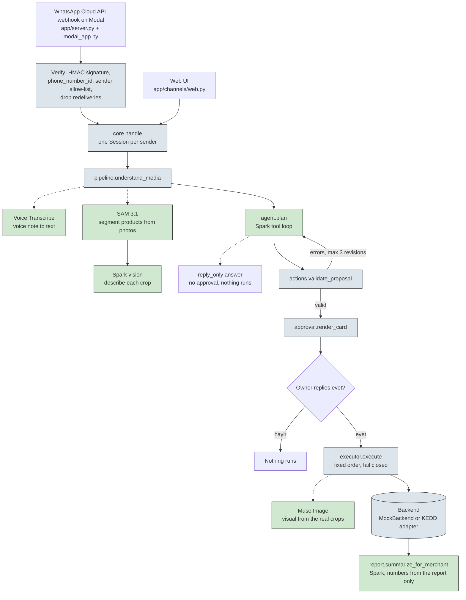

# Architecture & security

How a merchant's voice note becomes executed business actions in the Merchant Action Agent, and why
nothing runs without the owner's approval. All paths and rules below are taken from the code as it is.



Green boxes are Meta model calls; blue-grey boxes are plain code; diamonds are the owner's decision.
Solid arrows are the main flow, dotted arrows are calls into a step.

## 1. The model proposes, code executes

The planner (`app/agent.py`, `TOOLS`) gets seven read-only tools — `get_store_profile`, `list_catalog`,
`find_customers`, `find_customer`, `get_schedule`, `find_appointments`, `get_daily_summary` — and two
ways to finish: `propose_actions` (a structured plan) or `reply_only` (a plain answer such as
"Bugün ne oldu?"). There is no write tool. A question answered with `reply_only` is returned by
`core.handle` directly and leaves nothing pending.

Writes exist only as data in a proposal. `app/actions.py` (`ACTION_TYPES`) allows eleven action types:
`add_catalog_item`, `create_discount`, `generate_visual`, `send_campaign`, `create_appointment`,
`reschedule_appointment`, `cancel_appointment`, `apply_bulk_price`, `adjust_loyalty`, `ads_action`.
A proposal is validated in code, shown to the owner as a card, and only then executed by
`app/executor.py` (`execute`), which maps each action to one backend call in a fixed order.
The model never sends a message, sets a price, or books anything by itself.

A real proposal, from `tests/test_offline.py::_proposal`:

```json
{
  "summary_tr": "1 çanta eklenecek, hafta sonu %15, 20 müşteriye mesaj.",
  "actions": [
    {"type": "add_catalog_item", "item_type": "product", "temp_id": "tmp1",
     "name": "Deri Çanta", "price": 850},
    {"type": "create_discount", "percent": 15, "item_refs": ["tmp1"],
     "starts": "2026-10-31", "ends": "2026-11-01"},
    {"type": "generate_visual", "visual_prompt": "leather bag", "item_refs": ["tmp1"]},
    {"type": "send_campaign", "segment_id": "seg101",
     "message": "Selam! Çanta 850 TL, hafta sonu %15 🎁", "attach_visual": true}
  ]
}
```

`app/approval.py` (`render_card`) turns it into the card the owner approves (rendered here by running
the function, segment `seg101` = 20 customers):

```text
*Çırak — onayına sunuyorum*

🛍️ Ürün: Deri Çanta — 850 ₺ 📷
🏷️ İndirim: %15 (2026-10-31 → 2026-11-01) — Deri Çanta
🖼️ Kampanya görseli üretilecek: “leather bag”
📣 WhatsApp: 20 müşteriye mesaj 📎 görsel eklenecek
   “Selam! Çanta 850 TL, hafta sonu %15 🎁”

Çırak'ın notu: 1 çanta eklenecek, hafta sonu %15, 20 müşteriye mesaj.

Onaylıyor musun? (evet / hayır)
```

Action lines come first and the model's note last, so the prose cannot frame what is about to
run. Item lines show the category and description that will actually be written; discount lines
name the affected items; third-party strings on the card are sanitised (no newlines, no `*`).

## 2. Validation rules

`app/actions.py` (`validate_proposal`) checks every proposal before it can reach the card. An invalid
proposal goes back to the model with structured errors (max 3 revisions in `agent.plan`, then it raises).

| Check | Failure it prevents |
|---|---|
| Proposal is an object with `summary_tr` and a non-empty `actions` list | Empty or shapeless plans |
| Every action type is one of the 10 known types; at most 12 actions per plan | Made-up or runaway write operations |
| Catalog name/description, messages and template variables carry no URL, e-mail, phone or IBAN | Contact details smuggled to customers |
| Offer words (`bedava`, `ücretsiz`, …) require a `create_discount` in the plan | Messages promising an unplanned deal |
| `add_catalog_item`: `item_type` is product or service | Wrong catalog entity |
| `add_catalog_item`: `temp_id` must come from this run's photos, else a text `ref` is required | Items detached from any evidence |
| `add_catalog_item`: no handle added twice or clashing with an existing id | Duplicate / colliding items |
| `add_catalog_item`: price is positive and ≤ 500,000 TRY; `name` required | Absurd or nameless prices |
| `add_catalog_item`: service `duration_minutes` is 5–600 | Unbookable services |
| `create_discount`: `percent` is an integer 1–70 (`MAX_DISCOUNT_PCT`) | Excessive discounts |
| `create_discount`: `item_refs` required and must resolve (new items first) | Discounts on unknown items |
| `create_discount`: ISO dates, `ends` ≥ `starts`, window ≤ 60 days | Open-ended sale prices |
| `generate_visual`: `visual_prompt` required, `item_refs` must resolve | Visuals of nothing |
| `send_campaign`: `segment_id` must come from a `find_customers` call in the same run | Messaging an invented audience |
| `send_campaign`: message required, ≤ 350 chars | Empty or truncated messages |
| `send_campaign`: `attach_visual` needs an earlier `generate_visual` | Campaigns promising a missing visual |
| `send_campaign`: every `%X` / `yüzde X` in the message must equal a planned discount percent | Message promising an unplanned discount |
| `send_campaign`: every `X TL` in the message must equal a planned price or sale price | Message promising an unplanned price |
| Appointment actions: human-readable `label` required | Cards the owner cannot understand |
| `create_appointment`: `customer_id` from `find_customer`, `item_ref` an existing service, `staff` set | Booking the wrong person, thing, or nobody |
| `reschedule`/`cancel`: `appointment_id` from a `find_appointments` call in the same run | Moving a guessed appointment |
| `create`/`reschedule`: `starts` is a naive ISO datetime | Unparseable times |
| Summary promises a campaign/message and a segment was built, but no `send_campaign` action (unless the summary explicitly says no message is sent) | Silent plans that over-promise |
| `create_discount`: `starts` is today or later; `item_refs` de-duplicated | Backdated sales, double-counted items |
| Appointment `starts` is in the future | Bookings in the past |
| `generate_visual` refs include a photo crop | Visuals silently dropping catalog items |

## 3. Channel security (WhatsApp path)

- Signature: `app/channels/whatsapp.py` (`verify_signature`) checks every POST against
  `X-Hub-Signature-256` (HMAC-SHA256 with the app secret); `app/server.py` answers 401 otherwise.
- Number check: `parse_webhook` accepts only messages addressed to our `phone_number_id`.
- Allow-list: `is_allowed` admits only senders in `WA_ALLOWED_SENDERS`; everyone else is ignored,
  not answered.
- De-duplication: Meta redelivers on timeouts, so `modal_app.py` keeps a `seen` dict and each
  message id is processed once (`first_time`).
- Single worker: the Modal worker runs with `max_containers=1` — one message at a time, so
  approvals and sessions can never race.
- Approval bound to the session: the pending proposal lives on the sender's `Session` in
  `app/core.py`; saying `evet` in other words still only approves your own card, pending cards
  expire after 2 hours, and buffered photos after 30 minutes.
- Consumed once: `_execute_pending` clears `session.pending` before executing ("one approval, one
  execution — even if this crashes"), a second `evet` cannot re-run, and `app/worker.py`
  (`process_inbound`) persists the session even on failure so a consumed approval stays consumed.
- Fail closed: `app/executor.py` (`execute`) stops at the first failed step, so a failed catalog
  or discount write never leads to messages being sent.
- Stale sessions: if a stored session cannot be loaded (e.g. a stale pickle after a deploy),
  the worker logs a warning and starts fresh instead of taking the channel down.

## 4. Data handling

Customer phone numbers never leave the backend: `find_customers` returns a `segment_id`, a count,
an `excluded_no_consent` count, and up to 5 sample rows without numbers, and the tool description
says so explicitly. The consent gate is enforced in code — customers without `marketing_consent`
are excluded from segments. Mock numbers are masked synthetics starting with `+90 5XX XXX`, never real.

Model ids in `app/config.py` carry no `-contributor` suffix: per the config comment and the README,
content sent in Standard mode is not used to train Meta models.

The mock backend simulates what a demo cannot do for real and labels it: `send_campaign` returns
"mock backend: messages are NOT sent; engagement is simulated", and `report()` carries
`"engagement_note": "simulated (mock backend)"`.

## 5. Meta models used

Matches the README table; the "where" column points at the call sites.

| Model id | Endpoint | Where in the code | What for |
|---|---|---|---|
| `muse-spark-1.3` | Responses API, tool calling | `app/agent.py` (`plan`, `responses.create`), `app/pipeline.py` (`infer_concept`, via `describe_image`), `app/report.py` (`summarize_for_merchant`) | Orchestration, concept noun for SAM, crop descriptions, merchant summaries |
| `muse-voice-transcribe-1.0` | `POST /v1/asr/transcribe` | `app/meta_client.py` (`transcribe`), via `app/pipeline.py` (`understand_media`) | Voice note → text |
| `sam-3.1` | Responses API (stream) | `app/meta_client.py` (`segment`, `responses.stream`), via `app/pipeline.py` | Product segmentation (boxes → crops) |
| `muse-image-1.0` | `POST /v1/images/edits` | `app/meta_client.py` (`generate_campaign_visual`), via `app/executor.py` | Campaign visual composed from the real crops |

## 6. Known limitations

- Judges run `MockBackend`: two fictional businesses with synthetic customers, revenue, and messages.
  The `KeddBackend` signed-HTTP adapter ships in `app/tools/backend.py` but no test or public run
  exercises it — the KEDD platform itself is closed source and not in this repo.
- The live SAM, Voice Transcribe, and Muse Image paths are exercised only through the
  `scripts/check_api.py` smoke script (`--audio`, `--image`, `--image-gen`); the offline suite
  covers parsing and the surrounding code, not the model calls.
- WhatsApp runs on a dedicated Meta dev app with a test number (`app/config.py`), not a production
  sender; only allow-listed senders can command the agent.
- One approver per conversation: whoever received the card approves it, and a pending card expires
  after 2 hours (`PENDING_TTL_S` in `app/core.py`).
